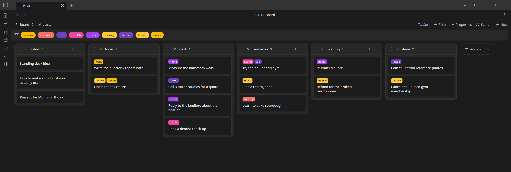
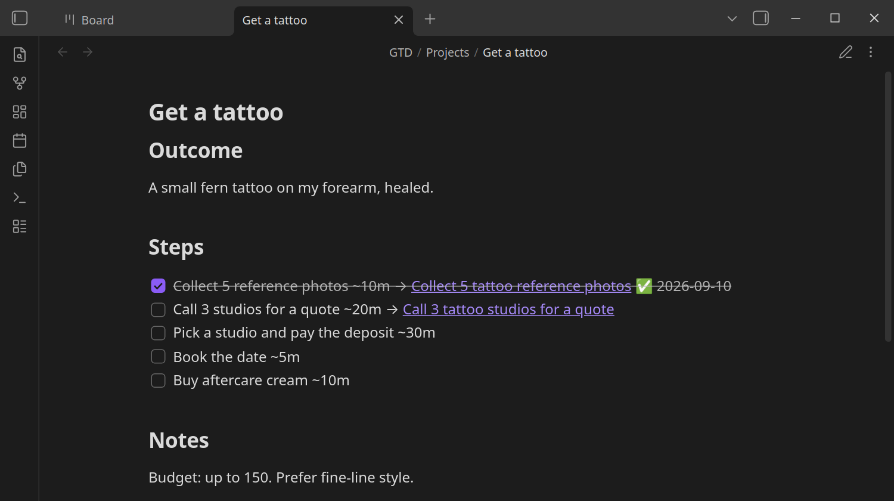

# llm-gtd

**A to-do system for Obsidian where the AI does the boring part.**

You dump thoughts in. Claude Code sorts, tags and files them. You just decide what to do.

[](docs/assets/demo.mp4)

*84-second demo. Click for the full-quality video.*

## Why it works for busy brains

- 🧠 **Capture takes seconds.** Drop a note or a web clip in the inbox. No sorting, no forms.
- 🧹 **Someone else does the admin.** Claude tags, files and cleans up — and asks before it changes anything.
- 🎯 **One next step, not twenty.** Big projects show only the step you can start today.
- 🔔 **Nothing rots quietly.** The weekly review points out what got stuck and suggests one way out.

It's inspired by the [llm-wiki idea](https://gist.github.com/karpathy/442a6bf555914893e9891c11519de94f):
**you capture and decide, the AI does the bookkeeping.**

## Get started

1. **Open a vault** in Obsidian (new or existing — your notes stay untouched).
2. **Install 2 plugins** (Settings → Community plugins): `Base Board` and `Templater`.
   `Base Board` must be 2.6.0+, on Obsidian 1.10.2+.
3. **Install the Claude Code plugin and run it.** In a terminal in the vault folder:

   ```sh
   claude plugin install gtd --marketplace cypiswhywhy/llm-gtd --scope project
   claude "/gtd:install"
   ```

4. **Flip one switch.** Settings → Templater → turn on *Trigger Templater on new file creation*, and
   add two Folder Templates: `GTD/Items` → `Templates/GTD Item.md` and
   `Pocket/Notes` → `Templates/Pocket Note.md`.

Done. Open `GTD/Board.base` to see your board.



## Every day

| Type this | What happens |
|---|---|
| `/gtd:triage` | Empties the inbox: tags each item and suggests a column. |
| `/gtd:review` | Weekly check-up: stuck projects, stale cards, old done items archived. |
| `/gtd:project I want to have a tattoo` | Turns a big goal into small steps. Only the first step becomes a card. |
| `/gtd:pocket` | Moves done items worth keeping to Pocket, and files what you clipped there. |
| `/gtd:pocket-import Reading` | Goes through a folder with you and moves the notes worth keeping to Pocket. |
| `/gtd:update` | Pulls in the latest version of the system. |

To finish something, drag its card to **done**.

## Big things: projects

"Buy a flat" never gets started — it's a result, not an action. `/gtd:project` asks what *finished*
looks like, then writes small steps with time estimates into a note in `GTD/Projects/`.



- **Only the active step is on the board**, so it stays a list of things you can do today.
- **Run `/gtd:project` with no argument** to tick off finished steps and move the next one up.
- **Stalled for 14 days?** `/gtd:review` names the stuck step and suggests one fix: a sweep, a smaller
  step, `waiting` on someone, or letting it go.

## Things to keep: Pocket

GTD is only for things to do. Pocket is for things to keep — an article you read and liked, a recipe,
a tool. It's a separate board in `Pocket/`, with its own tags, and its columns are categories instead
of statuses.

- **Read it, drag it to done, then `/gtd:pocket`.** It proposes a category and tags, and moves the note
  once you say yes. `/gtd:triage` and `/gtd:review` suggest it too.
- **Already know you want to keep it?** Clip it with the Pocket web-clipper template. It lands in the
  unsorted column until `/gtd:pocket` files it.
- **Already have a folder of saved articles?** `/gtd:pocket-import <folder>` goes through it with you,
  20 notes at a time, and moves only the ones you say yes to. The rest stay where they are.
- **A new category is just a new column.** Nothing to set up.

## Coming from Notion

1. In Notion, export as **Markdown & CSV** (all rows).
2. Drop the zip into a `.gtd-import/` folder in your vault. No need to unzip. (Leaving it in
   `~/Downloads/` usually works too.)
3. Run `claude` in the vault folder and paste this:

   ```text
   Import my Notion export into this vault.

   1. Download this file with curl and read all of it:
      https://raw.githubusercontent.com/cypiswhywhy/llm-gtd/main/import-notion.md
      (Don't use a web-fetch tool. It summarizes.)
   2. Follow the prompt between its two `---` lines exactly,
      as if I had pasted it in.
   ```

It shows you how your Notion statuses map to the board and writes nothing until you say yes.
Long-finished items go straight to the archive, so the board opens clean.

## Board lost its tag colors? (Obsidian 1.14+)

Obsidian 1.14 added its own kanban view under the name `Base Board` used to use, so it drew your
boards instead: tags lost their colors, columns stopped collapsing. `Base Board` 2.6.0 fixed it.

1. In Obsidian: Settings → Community plugins → update `Base Board` to 2.6.0 or newer.
2. Update the `gtd` plugin — see [Updating](#updating) below.
3. In Claude Code, in the vault: `/gtd:update`. It points both boards at the renamed view.

## Items jumping back to `inbox`?

Up to schema v16 the Templater templates wrote their own `status: inbox` over a note's frontmatter.
Templater fills in every note with no body that appears in `GTD/Items/`, and that includes a note
renamed from outside Obsidian. So a card added with `+` to any column landed in `inbox`, and an item
`/gtd:triage` renamed went back to `inbox` with a new `created` date. The v17 templates fill in only
the keys a note is missing.

1. Update the `gtd` plugin — see [Updating](#updating) below.
2. In Claude Code, in the vault: `/gtd:update`. It replaces both templates and lists items whose
   status the old template probably reset, so you can put them back.
3. In Obsidian: Settings → Templater → Folder Templates → add `Pocket/Notes` →
   `Templates/Pocket Note.md`, so cards from the Pocket board's `+` get their frontmatter too.

## Updating

`/gtd:update` says "already up to date" but you expected something new? The plugin itself is old.
In a terminal, in your vault folder:

1. `claude plugin marketplace update llm-gtd`
2. `claude plugin update gtd@llm-gtd --scope project`
3. Start Claude Code again in the vault (`claude`) and run `/gtd:update`.

Inside Claude Code you can type the first two with a `!` in front, then `/exit` and start again.
From plugin 1.2.0 on, `/gtd:update` checks this itself and offers to do it for you.

<details>
<summary><b>What it adds to your vault</b></summary>

```
CLAUDE.md               # the rules the AI follows
GTD/Board.base          # kanban board + Inbox / Stale / All items views
GTD/Items/              # one note per item
GTD/Projects/           # one note per project — never a card
GTD/Archive/            # old done items
GTD/Attachments/        # files an import brought along (only if needed)
GTD/Log.md              # log of everything the AI did
Pocket/Board.base       # Pocket board, one column per category
Pocket/Notes/           # one note per thing you kept
Templates/GTD Item.md   # template for new items
Templates/Pocket Note.md  # template for new Pocket notes
clipper/                # Obsidian Web Clipper templates (GTD inbox, Pocket)
.claude/settings.json   # enables the gtd plugin in this vault (written by `claude plugin install`)
```

Nothing else in your vault is read, moved or changed. If a file already exists, it stops and asks.

</details>

<details>
<summary><b>What's in this repo</b></summary>

The system is a Claude Code plugin, `gtd`, in [`plugins/gtd/`](plugins/gtd/). The rest are prompts you
paste in once, when you need them.

| File | Use it to |
|---|---|
| [`install.md`](install.md) | Set up a vault, step by step. |
| [`update.md`](update.md) | Move a vault installed before the plugin onto it. Its old `/gtd-update` does this for you. |
| [`import-notion.md`](import-notion.md) | Move in from Notion or a CSV, once. |
| [`install.html`](install.html) | The same setup as a web page with a copy button. |

Updating the plugin updates the commands; `/gtd:update` then migrates the vault's data. Maintainer notes
live in [`CLAUDE.md`](CLAUDE.md).

</details>
